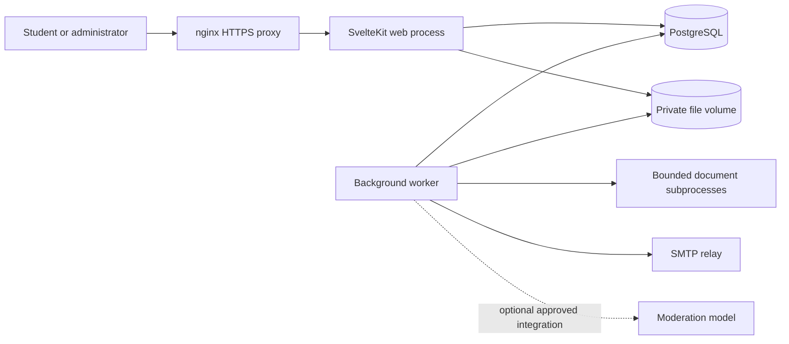

# Architecture and shared contracts

## Runtime layout



The web and worker processes use the same source modules and release version. Web requests authenticate, validate, execute short transactions, and enqueue work. Workers perform document analysis, email delivery, archive preparation, and scheduled maintenance. Their execution does not depend on incoming page views.

Initial deployment uses a single host and private filesystem volumes. More web replicas require shared sessions, database-backed rate limits, and access to the same file storage. Scaling across hosts requires a shared storage solution first. Worker count and concurrency are configured separately from web capacity.

SvelteKit's Node adapter supplies the production web server. pg-boss supplies the queue. Their configuration and lifecycle follow the pinned releases' documented APIs. [SvelteKit deployment](https://svelte.dev/docs/kit/adapter-node), [pg-boss](https://pgboss.io/)

## Source layout

Proposed layout once implementation begins:

```text
src/
  routes/                  Pages, form actions, download/status endpoints
  lib/
    components/            Shared accessible UI components
    i18n/                  German and English messages
    server/
      auth/                Better Auth configuration and access policies
      catalogue/           Lectures, examiners, search
      submissions/         Revisions and private storage
      moderation/          Rules, assessments, decisions
      credits/             Ledger and access grants
      jobs/                Registered tasks, scheduling, controls
      notifications/       Templates and delivery
      audit/               Events and operational summaries
      db/                  Schema, connection and migrations
worker/                    Worker entry point and process lifecycle
scripts/                   Explicit migration and maintenance commands
tests/                     Integration, browser and concurrency tests
deploy/                    Docker, proxy and release configuration
docs/                      This specification
```

Use ordinary functions and explicit imports. Introduce no internal HTTP calls, generic repository framework, plugin loader, or event bus for module-to-module calls. The queue is for durable asynchronous work. Business functions accept a transaction where a workflow spans modules.

## Boundary rules

1. Route handlers call domain functions; domain functions own validation of business rules and writes.
2. Shared browser types contain safe response fields only. Database rows, credentials, reviewer notes and extracted document text do not become page data by default.
3. All mutations require an authenticated actor or a narrowly defined system task. Recheck the admin flag, account state and object access on the server.
4. A state-changing operation has an idempotency key and/or a unique business constraint where retries can repeat effects. Do not create generic infrastructure for harmless read requests.
5. Domain changes and their next job are committed in one PostgreSQL transaction using the documented queue integration. The outbox dispatcher uses the same node-postgres client for pg-boss insertion and dispatch acknowledgement; integration tests verify rollback and retry behaviour.
6. File writes and SMTP are outside database transactions. They use the explicit recovery rules in their modules; database transactions cannot make them atomic.

## Access levels and scope

| Capability | Student | Student with admin flag |
|---|---|---|
| Browse catalogue, submit protocols and improve own submissions | Yes | Yes |
| Delete submitted protocols/revisions or withdraw publication | No | Subject to moderation and retention policies |
| Download published protocols | Active lecture access | Also through audited review access |
| Review safe submitted files | Own files only | Yes |
| Decide publication and shared reward | No | Yes |
| Adjust balances or resolve token requests | No | Yes |
| Change admin flags, suspend accounts, configure policies | No | Yes |
| Retry analysis of a submission | No | Yes |
| Pause queues, edit schedules, run maintenance | No | Yes |
| Read infrastructure diagnostics | No | Yes |

The user selected a simple `isAdmin` boolean, default false. Account state is separate. All administrators are verified zx students; there is no separate staff identity provider or address exception. A suspended or deletion-pending account cannot use old sessions to regain access. The initial admin flag is assigned through a controlled bootstrap command to a nominated verified account.

## Shared request contracts

Reads use GET. Mutations use POST form actions or endpoints with origin/CSRF protections; no state changes via links. JSON is used for job polling and upload endpoints where useful. A public REST API is outside initial scope.

Domain functions validate IDs, enum values, lengths and file limits at runtime. TypeScript types alone do not validate network input. Return field errors for invalid forms, 401 for absent authentication, 403 for denied capabilities, 404 for concealed inaccessible objects, 409 for stale versions, and 429 for throttling. Unexpected failures produce a request ID and a generic message; detailed errors remain in restricted logs.

Updates to submissions, decisions, settings and schedules carry an expected version. A stale reviewer or worker receives a conflict and must reload. Workflow completion checks the submission revision and analysis generation so late results cannot overwrite newer work. File-safety verdicts use their own per-file check generation, so the still-published file can be blocked while a replacement is pending. Content-model calls and automatic decisions remain disabled placeholders in the core release; document workers perform technical checks only.

## Time, configuration and observability

Persist instants in UTC using `timestamptz`. Display dates and schedule times in Europe/Berlin by default. Use calendar dates for exam dates; preserve uncertainty for imported metadata.

Deployment secrets live in environment/secret files. Website-editable configuration is limited to typed product policies, task schedules and bounded concurrency controls. Each update records actor, previous version, new version and reason. The browser cannot change database credentials, executable commands, or deployment images.

Pass request, submission, job and release identifiers through structured logs. Operational readiness checks are read-only. Audit history survives queue-history cleanup.

## Proposed service targets

These are validation targets, not measured capacity guarantees:

- Common authenticated catalogue reads: server response p95 below 500 ms on representative staging data at 50 concurrent simulated users.
- Benchmark with at least the current production dataset size, plus an agreed growth case after inventory. Report hardware, document mix and test duration.
- Accepted uploads persist before acknowledgement; processing can continue after the browser closes.
- Admin job status refreshes within five seconds under normal operation.
- A worker crash does not lose queued work or duplicate rewards. SMTP may require duplicate-tolerant delivery.
- Mobile layout at 360 px and complete keyboard operation of core flows; target WCAG 2.2 AA, verified through automated checks and manual interaction tests.
- Proposed recovery objectives: at most 24 hours of data loss and restoration within four hours. Operators must agree and demonstrate these before launch.
